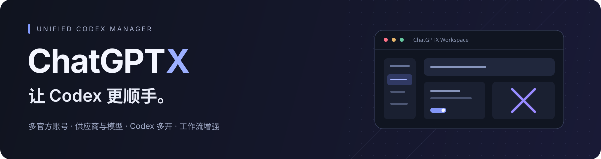

<p align="center">
  
</p>

<p align="center">
  <a href="README.md">中文</a> | English
</p>

<p align="center">
  <a href="https://github.com/aurorax-neo/chatgptx/releases"></a>
  <a href="https://github.com/aurorax-neo/chatgptx/stargazers"></a>
  <a href="LICENSE"></a>
  
  
</p>

ChatGPTX is a unified management application for the OpenAI Codex / ChatGPT desktop app. Built with Rust and Tauri, it uses the Chromium DevTools Protocol (CDP) and an embedded runtime for multi-account official login management, third-party API provider switching, protocol conversion, isolated multi-instance launching, session management, and UI enhancements without modifying the official app's `app.asar` or installation files.

## Key Features

| Area | Capabilities |
| --- | --- |
| **Official Accounts** | Multi-account OAuth PKCE browser sign-in, manual callback parsing, import from local `auth.json` / macOS Keychain / JSON / Token, automatic token refresh, real-time 5h / weekly / monthly quota inspection, one-click switch without re-login, and per-account third-party API provider binding |
| **API & Aggregate Providers** | Pure API providers and aggregate providers (Failover & Model aggregation); Responses / Chat Completions conversion; model tests, model discovery, and Provider Doctor |
| **Codex Multi-Launch** | Start isolated Codex instances for both official accounts (pure or bound to a third-party API provider) and API providers, each with its own config, sessions, and user data directory |
| **Models & Context** | Per-model context windows (`model[1M]`), auto-compact limits, `model_catalog_json` generation, model metadata import, and per-provider MCP, Skill, and Plugin selection |
| **Session Management** | Local session scanning, bulk deletion, Markdown export, token usage history, project moves, thread IDs, and cross-provider session sync |
| **Enhancements & Proxy** | Usage status line (tok/s, cache hit rate, context share), dictation, paste fix, conversation width, next-step suggestions, typing effects, user script marketplace, and unified global proxy settings |

## Quick Start

Download the latest installer from [GitHub Releases](https://github.com/aurorax-neo/chatgptx/releases):

- **Windows (x64)**: `ChatGPTX-*-windows-x64-setup.exe`
- **macOS (Apple Silicon & Intel Universal)**: `ChatGPTX-*-macos-universal.dmg`

1. Ensure the official Codex / ChatGPT desktop app is installed on your machine.
2. Open **ChatGPTX**, sign in or import official accounts under **Official Accounts**, or configure API providers under **Provider Configuration**.
3. Click **Use** on an account or provider and choose **Use only (effective on restart)** or **Use and restart Codex**.
4. Use the top-right **Launch Codex**, **Stop Codex**, or **Restart Codex** controls for the main instance, or open **Codex Multi-Launch** to run multiple isolated instances side by side.

## Account and Provider Modes

| Mode | Purpose | Authentication Boundary |
| --- | --- | --- |
| **Official Account (Pure)** | Use an official ChatGPT / Codex account directly | Writes official OAuth tokens to `auth.json` and macOS Keychain, clearing custom model overrides |
| **Official Account + Bound API** | Keep official account state and plugins while routing model requests to a bound third-party API provider | Writes official OAuth tokens alongside the bound provider configuration |
| **Pure API Provider** | Use a custom Base URL and API key without an official account | Deactivates official OAuth tokens and maintains independent `config.toml` and API-key auth |
| **Aggregate Provider** | Failover (fail over or rotate across providers) and Model aggregation (bind catalog models to specific members) | Merges or routes models across API providers and official accounts |

## Data Locations

- Codex config: `~/.codex/config.toml`
- Codex auth state: `~/.codex/auth.json` (synced with macOS Keychain `"Codex Auth"`)
- Codex local database: `~/.codex/sqlite/*.db` (falls back to `~/.codex/state_5.sqlite`)
- ChatGPTX state and logs: `~/.chatgptx/`
- Multi-launch instance directories: `~/.chatgptx/codex-multi/<instance-id>/`

## Development

```bash
cd apps/chatgptx-manager
npm ci
npm run check
npm test
npm run vite:build

cd ../..
cargo test --workspace --lib
cargo build --release -p chatgptx-manager --bin chatgptx
```

## Credits & License Compliance

### 1. Credits
- **[BigPizzaV3/CodexPlusPlus](https://github.com/BigPizzaV3/CodexPlusPlus)** (`AGPL-3.0-only`): Upstream base repository providing the core launcher architecture, provider switching, protocol conversion, model catalog generation, and Codex UI enhancements.
- **[jlcodes99/cockpit-tools](https://github.com/jlcodes99/cockpit-tools)** (`CC-BY-NC-SA-4.0`): Reference for multi-account official OAuth PKCE sign-in, automatic token refresh, real-time quota inspection, and global network proxy design.
- **[MeteorNOX/DeepSeek-Balance-Whale-Widget](https://github.com/MeteorNOX/DeepSeek-Balance-Whale-Widget)** (Code `MIT`) & **[Yang-huai406/Codex-Whale-Public](https://github.com/Yang-huai406/Codex-Whale-Public)**: Source of the optional usage widget and character assets. See [Upstream LICENSE](assets/inject/upstream/whale-widget/LICENSE) and [PROVENANCE.md](assets/inject/upstream/whale-widget/PROVENANCE.md).

### 2. License & Disclaimer
- **Open-Source License**: Licensed under the [GNU Affero General Public License v3.0](LICENSE) (SPDX: `AGPL-3.0-only`). See [THIRD_PARTY_NOTICES.md](THIRD_PARTY_NOTICES.md) for complete third-party attribution and provenance notices.
- **Copyright**:
  - `Copyright (C) 2026 BigPizzaV3 and contributors` (Upstream code)
  - `Copyright (C) 2026 aurorax-neo` (ChatGPTX derivative modifications and additions)
- **Compliance & Disclaimer**:
  - Redistribution of modified versions or network deployment must provide the complete corresponding source code and preserve copyright notices under AGPL-3.0. Designs referencing `cockpit-tools` (`CC-BY-NC-SA-4.0`) are for personal learning, research, and non-commercial use only.
  - OpenAI, ChatGPT, and Codex are trademarks of OpenAI, L.L.C. This project is not affiliated with or endorsed by OpenAI.

---

<p align="center">
  <br>
  <strong>ChatGPTX</strong><br>
  <sub><a href="https://github.com/aurorax-neo/chatgptx">github.com/aurorax-neo/chatgptx</a> · <a href="LICENSE">AGPL-3.0-only</a> · <a href="THIRD_PARTY_NOTICES.md">Third-Party Notices</a></sub>
</p>
